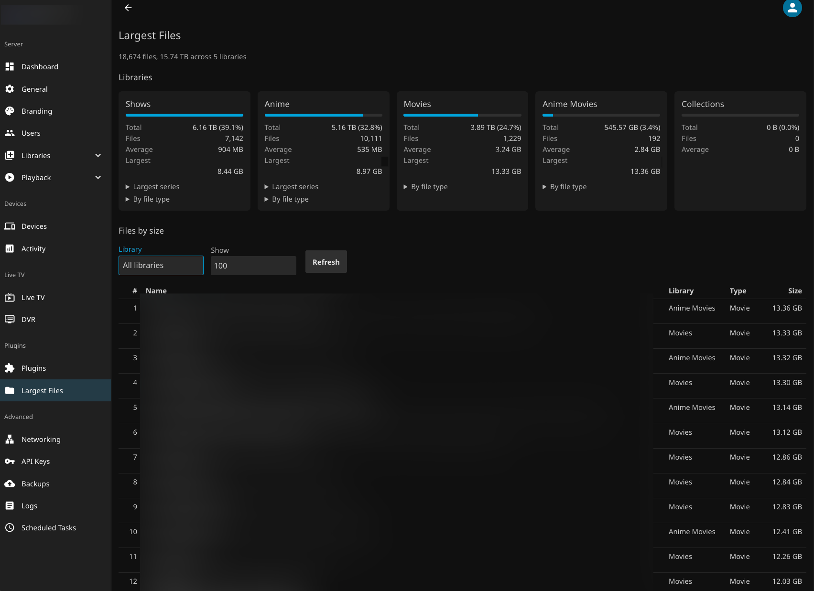

# Largest Files for Jellyfin

[](https://github.com/oppahansi/largestfiles/actions/workflows/build.yml)
[](LICENSE)

A Jellyfin plugin that shows which files take up the most space in your libraries, plus storage statistics per library.



## Features

- **Files by size:** every media file in your libraries, largest first. Filter by library and choose how many to show (up to 5000). Each entry links to its Jellyfin page and shows the file path.
- **Library cards:** for each library, its total size and share of the whole server, file count, average file size and largest file.
- **Largest series:** the 10 TV series that use the most space in each library, summed over all episodes.
- **Size by file type:** how much space each container format (mkv, mp4, flac, …) uses.
- **JSON API:** `GET /LargestFiles/Report` for scripts and dashboards such as Homepage or Grafana.

The page is only visible to administrators and doesn't change anything on disk. The plugin doesn't make any network requests.

## Compatibility

| Jellyfin | .NET | Release tag |
|---|---|---|
| 12.2.x | 10 | `v<version>-jellyfin-12.2` |
| 12.1.x | 10 | `v<version>-jellyfin-12.1` |
| 12.0.x | 10 | `v<version>-jellyfin-12.0` |
| 10.11.x | 9 | `v<version>-jellyfin-10.11` |
| 10.10.x | 8 | `v<version>-jellyfin-10.10` |
| 10.9.x | 8 | `v<version>-jellyfin-10.9` |

Each plugin version is released once per Jellyfin line. Pick the release that matches your server's version, shown at the top of the dashboard.

## Installation

### From the plugin repository (recommended)

Jellyfin picks the right build for your server and updates it automatically.

1. Go to **Dashboard → Plugins** and open the repository settings (**Repositories** tab or **Manage repositories**, depending on your Jellyfin version).
2. Add a repository:
   - Name: `Largest Files`
   - URL: `https://raw.githubusercontent.com/oppahansi/largestfiles/main/manifest.json`
3. Open the **Catalog**, find **Largest Files** under *General* and install it.
4. Restart Jellyfin.
5. Open **Dashboard → Largest Files**.

### Manual install

1. Download the zip for your Jellyfin version from [Releases](https://github.com/oppahansi/largestfiles/releases).
2. Extract it into a new folder in Jellyfin's plugin directory, for example `<config>/plugins/LargestFiles_1.0.0/`.
   - Docker: `/config/plugins/`
   - Linux packages: `/var/lib/jellyfin/plugins/`
   - Windows: `%ProgramData%\Jellyfin\Server\plugins\`
3. Restart Jellyfin.

## API

```
GET /LargestFiles/Report?limit=100&libraryId=<library id>
```

Requires an administrator API key or session (`Authorization: MediaBrowser Token="<key>"` or `X-Emby-Token`).

| Parameter | Default | Description |
|---|---|---|
| `limit` | `100` | Number of files in the `Files` list, 1 to 5000 |
| `libraryId` | all | Only list files from this library. Library stats always cover every library |

The response contains `TotalFiles`, `TotalSize`, `Libraries` (stats per library, largest first) and `Files` (largest first). Sizes are in bytes.

## How sizes are measured

- Movie and episode sizes come from Jellyfin's database, which fills them in during library scans.
- Items without a stored size (music, for example) are measured by reading the file's size from disk. For a large music library on network storage, the first load can take a few seconds.
- A file that contains several episodes is counted once.
- Disc folders (Blu-ray/DVD rips stored as folders) only show up if Jellyfin stored a size for them.
- The report is computed fresh each time the page loads; there's no cache.

## Building

Requirements: the [.NET 10 SDK](https://dotnet.microsoft.com/download). It can also build the .NET 8 and .NET 9 targets used by older Jellyfin versions.

Build against the newest supported Jellyfin version:

```sh
dotnet build Jellyfin.Plugin.LargestFiles -c Release
```

### Building for a different Jellyfin version

Pass the Jellyfin version you want to build against. The matching .NET target framework is chosen automatically:

```sh
dotnet build Jellyfin.Plugin.LargestFiles -c Release -p:JellyfinVersion=10.10.7
```

| `JellyfinVersion` | Target framework |
|---|---|
| 10.9.x, 10.10.x | `net8.0` |
| 10.11.x | `net9.0` |
| 12.x | `net10.0` |

Use any version of the [`Jellyfin.Controller`](https://www.nuget.org/packages/Jellyfin.Controller) NuGet package. Builds made against the latest patch release of a line work on every patch release of that line.

### Packaging

`scripts/package.sh` builds and packages one Jellyfin version as an installable zip (the DLL plus `meta.json`):

```sh
scripts/package.sh 10.11.11 1.0.0
# -> dist/largestfiles_1.0.0_jellyfin-10.11.zip
```

Package every supported version:

```sh
for v in $(jq -r '.[]' targets.json); do scripts/package.sh "$v" 1.0.0; done
```

### Versioning

Plugin versions use [semantic versioning](https://semver.org). Jellyfin needs every build in the repository manifest to have its own version, so the fourth component encodes the Jellyfin line. For example, `1.0.0.1011` is plugin `1.0.0` built for Jellyfin `10.11`, and `1.0.0.1202` is the build for `12.2`.

## Releasing

1. Add a section for the new version to [CHANGELOG.md](CHANGELOG.md) and push it to `main`.
2. Run the **Release** workflow under *Actions* and enter the version (for example `1.1.0`).

The workflow builds every version in [`targets.json`](targets.json), publishes one GitHub release per Jellyfin line and commits the updated `manifest.json`.

To support a new Jellyfin version, add it to `targets.json`. If it uses a newer .NET version, also extend the `TargetFramework` conditions in the `.csproj`.

## Contributing

Bug reports, ideas and pull requests are welcome. See [CONTRIBUTING.md](CONTRIBUTING.md).

## License

[MIT](LICENSE) © oppahansi

This project is not affiliated with the Jellyfin project.
